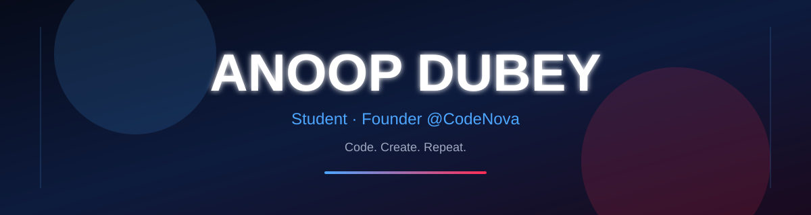
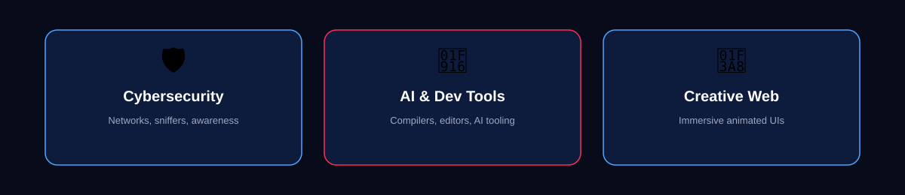
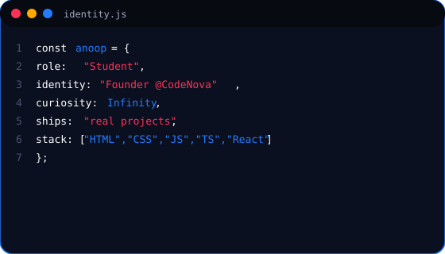
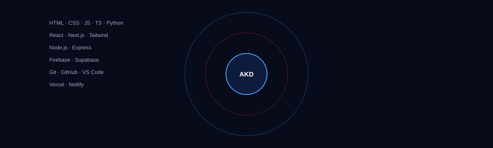
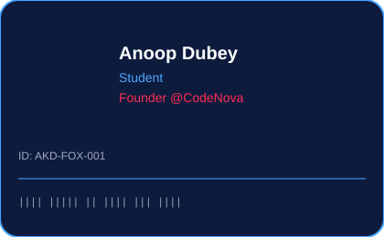
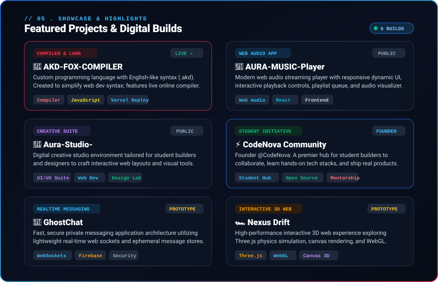
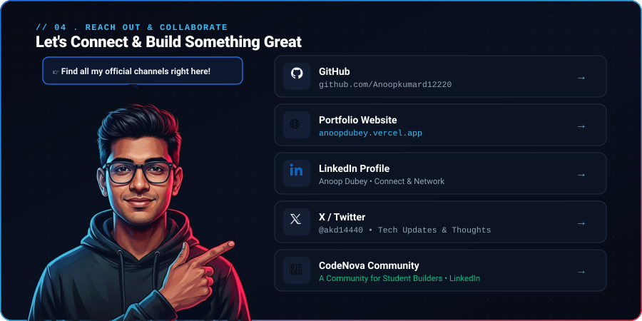

# ANOOP DUBEY

  

  <a href="https://github.com/Anoopkumard12220">GitHub</a> ·
  <a href="https://anoopdubey.vercel.app">Portfolio</a> ·
  <a href="https://www.linkedin.com/in/anoop-dubey-4a52a5380/">LinkedIn</a> ·
  <a href="https://x.com/akd14440">X</a> ·
  <a href="https://www.linkedin.com/company/codenova-community/">CodeNova</a>

  

  

  

  

  

**Project links:**  
[AKD-FOX](https://github.com/Anoopkumard12220/AKD-FOX-COMPILER) · [AURA Music](https://github.com/Anoopkumard12220/AURA-MUSIC-Player) · [Aura Studio](https://github.com/Anoopkumard12220/Aura-Studio-) · [CodeNova](https://github.com/Anoopkumard12220/CodeNova) · [Nexus Drift](https://github.com/Anoopkumard12220/nexus-drift)

  

  <a href="https://github.com/Anoopkumard12220">GitHub</a> ·
  <a href="https://anoopdubey.vercel.app">Portfolio</a> ·
  <a href="https://www.linkedin.com/in/anoop-dubey-4a52a5380/">LinkedIn</a> ·
  <a href="https://x.com/akd14440">X</a> ·
  <a href="https://www.linkedin.com/company/codenova-community/">CodeNova</a>

Designed with curiosity. Built by Anoop Dubey.

